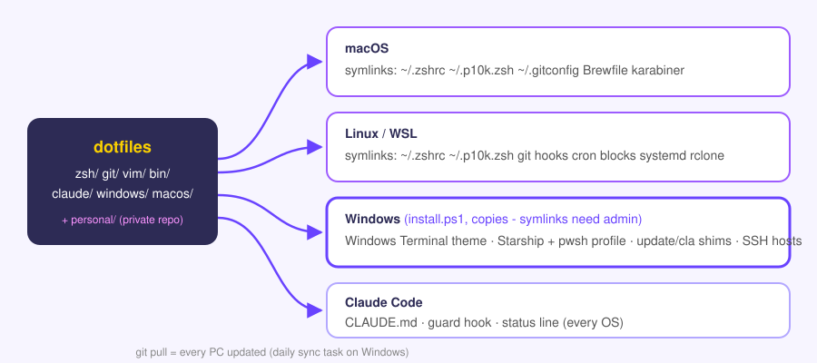

<div align="center">

<picture>
  <source media="(prefers-color-scheme: dark)" srcset="docs/images/brand/wordmark-dark.svg">
  
</picture>

# dotfiles

**macOS, Linux, WSL, Windows 개발 환경을 하나의 레포로 통합하는 셸·Git·Vim·Claude Code 설정 모음.**

Unix에서는 심볼릭 링크로, Windows에서는 복사로 연결하며 공개 기본값과 개인 설정을 분리해 관리합니다.


[](LICENSE)

[빠른 시작](#빠른-시작) · [가이드](docs/guide.ko.md) · [Ubuntu 수동 설정](setup/MANUAL.md) · [English](README.md)

</div>

<p align="center"></p>

<p align="center"><sub>하나의 레포를 모든 PC에 연결합니다: macOS·Linux·WSL은 <code>install.sh</code> 심볼릭 링크, Windows는 <code>install.ps1</code> 복사를 사용합니다.</sub></p>

## 빠른 시작

```bash
gh repo clone <owner>/dotfiles ~/git/dotfiles
~/git/dotfiles/install.sh --profile vanilla     # 또는 personal
```

`install.sh`는 셸, Git, Vim, Claude Code 설정을 `~`에 심볼릭 링크로 연결하고 선택한 프로필을 `~/.config/dotfiles/profile`에 저장합니다. `vanilla` 프로필은 범용 기본값만 설치하며 Git 이름과 이메일을 입력받아 `~/.gitconfig.local`에 기록합니다. `personal` 프로필은 `origin` 옆의 비공개 `personal/` 레포를 함께 clone합니다(`DOTFILES_PERSONAL_REPO`로 경로를 바꿀 수 있습니다).

새 PC를 처음부터 구성할 때는 OS별 부트스트랩 스크립트를 먼저 실행합니다:

| OS | 부트스트랩 명령 | 설치 및 설정 항목 |
|---|---|---|
| macOS | `curl -fsSL https://raw.githubusercontent.com/<owner>/dotfiles/main/setup/macos.sh -o setup.sh && bash setup.sh` | Xcode CLT, Homebrew, gh, uv, Oh My Zsh + p10k, Nerd Font, `install.sh --brew` |
| Ubuntu | `bash setup/ubuntu.sh` | apt 패키지, gh, uv, Node (nvm), Oh My Zsh + p10k, 데스크톱 앱, `install.sh --claude-md` |
| WSL | `bash setup/wsl.sh` | apt 패키지, uv, Oh My Zsh + p10k, Windows 데스크톱 글꼴, `install.sh` |
| Windows | `pwsh -File windows\setup.ps1` | `windows/winget-packages.json` 기반 `winget import`, `windows/install.ps1` |

브라우저 로그인이 필요한 단계(GitHub, SSH 키, Google Drive, Claude Code)는 [setup/MANUAL.md](setup/MANUAL.md)에서 안내합니다.

## 주요 기능

- **하나의 레포, 모든 OS**: macOS·Linux·WSL은 심볼릭 링크(`install.sh`), Windows는 `install.ps1` 복사로 구성해 `git pull`이나 `pull-all`만으로 모든 PC를 즉시 갱신합니다.
- **프로필 분리 (`vanilla` / `personal`)**: 공개 가능한 범용 설정과 비공개 `personal/`(Git 신원 허용 목록, SSH 호스트, 호스트 크론, 개인 Claude 에이전트)을 분리해 관리합니다.
- **전역 Git 훅 & 로컬 CI**: `pre-commit` 신원 검사, `commit-msg` 영문 전용 검사, `pre-push` `ci-local.py`로 푸시할 커밋을 격리된 워크트리에서 미리 검증합니다.
- **호스트 간 동기화 도구**: `bin/pull-all`, `bin/cron-install`, `bin/ssh-keys-sync`, `bin/repos-doctor`, `bin/gh-protect`로 레포지토리, 크론, SSH 키를 일관되게 유지합니다.
- **Claude Code 상태줄 & 가드**: 시스템 메트릭 HUD(`claude/hud/statusline.sh`)와 비밀값 유출·위험 명령·운영 체크아웃 브랜치 변경을 막는 `PreToolUse` 가드(`claude/hooks/guard.py`)를 포함합니다.

## 계층과 프로필

```text
zsh/zshrc               모든 OS
  └ zsh/os/<os>.zsh     darwin · linux · wsl (wsl은 linux를 먼저 불러옵니다)
      └ ~/.zshrc.local  이 PC 전용 — 비밀값, 호스트 하나용 별칭 (커밋하지 않음)
```

이 레포지토리에는 비밀값을 저장하지 않습니다. API 키, 토큰, 호스트별 설정은 `~/.zshenv.local`, `~/.zshrc.local`, `~/.gitconfig.local`에 작성합니다. 전체 심볼릭 링크 맵과 도구별 상세 설명은 [docs/guide.ko.md](docs/guide.ko.md)를 참고하시기 바랍니다.

## 문서

| 문서 | 내용 |
|---|---|
| [가이드](docs/guide.ko.md) | 계층 및 심볼릭 링크 맵, 비밀값, 커밋 신원 검사, `pull-all`, `update`, Windows PowerShell 및 터미널, Claude Code 상태줄 및 가드, 검사 |
| [Ubuntu 수동 설정](setup/MANUAL.md) | GitHub, SSH 키, Google Drive, Claude Code 등 브라우저 로그인 안내 |
| [English README](README.md) | 영문 README ([Guide](docs/guide.md)) |

## 기여

- **PR 워크플로우**: 브랜치를 만들어 PR로 변경 사항을 제출합니다(`main` 브랜치에는 직접 push할 수 없습니다).
- **커밋 메시지**: 영문 Conventional Commits 형식(`feat(install): ...`, `docs(readme): ...`)을 사용합니다.
- **사전 검사**: 커밋 전 `python3 tests/check_no_personal.py`를 실행하며, `pre-push` 훅이 `ci-local.py`로 `.github/workflows/ci.yml`을 로컬에서 검증합니다.

## 라이선스

MIT — [LICENSE](LICENSE)에서 확인하실 수 있습니다.
