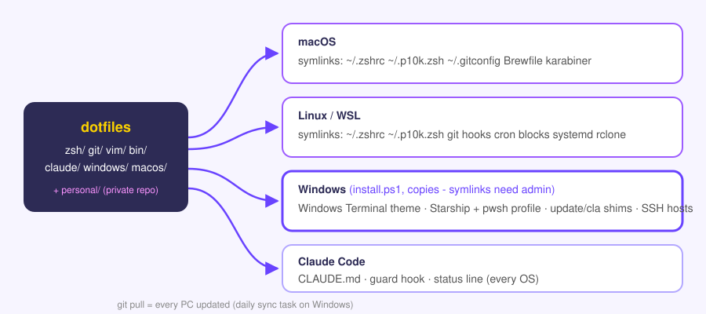

<div align="center">

<picture>
  <source media="(prefers-color-scheme: dark)" srcset="docs/images/brand/wordmark-dark.svg">
  
</picture>

# dotfiles

**Unified shell, Git, Vim, and Claude Code configuration across macOS, Linux, WSL, and Windows.**

Symlinked on Unix and copied on Windows, with public defaults separated from private overlays.


[](LICENSE)

[Quick start](#quick-start) · [Guide](docs/guide.md) · [Ubuntu manual](setup/MANUAL.md) · [한국어](README.ko.md)

</div>

<p align="center"></p>

<p align="center"><sub>One repo across every machine: macOS, Linux, and WSL symlink via <code>install.sh</code>; Windows copies via <code>install.ps1</code>.</sub></p>

## Quick start

```bash
gh repo clone <owner>/dotfiles ~/git/dotfiles
~/git/dotfiles/install.sh --profile vanilla     # or personal
```

`install.sh` symlinks shell, Git, Vim, and Claude Code configs into `~` and saves your profile to `~/.config/dotfiles/profile`. `vanilla` installs general-purpose defaults and prompts for your git name and email; `personal` clones `personal/` alongside `origin` (overridable via `DOTFILES_PERSONAL_REPO`).

On a fresh machine, run the OS setup script first:

| OS | Bootstrap command | What it sets up |
|---|---|---|
| macOS | `curl -fsSL https://raw.githubusercontent.com/<owner>/dotfiles/main/setup/macos.sh -o setup.sh && bash setup.sh` | Xcode CLT, Homebrew, gh, uv, Oh My Zsh + p10k, Nerd Font, `install.sh --brew` |
| Ubuntu | `bash setup/ubuntu.sh` | apt packages, gh, uv, Node (nvm), Oh My Zsh + p10k, desktop apps, `install.sh --claude-md` |
| WSL | `bash setup/wsl.sh` | apt packages, uv, Oh My Zsh + p10k, Windows desktop fonts, `install.sh` |
| Windows | `pwsh -File windows\setup.ps1` | `winget import` from `windows/winget-packages.json`, `windows/install.ps1` |

Browser logins (GitHub, SSH keys, Google Drive, Claude Code) are documented in [setup/MANUAL.md](setup/MANUAL.md).

## What's inside

- **One repo, every OS**: Symlinked on macOS, Linux, and WSL (`install.sh`) and copied on Windows (`install.ps1`), so `git pull` or `pull-all` updates every machine in place.
- **Profile separation (`vanilla` / `personal`)**: Keeps reusable public defaults separate from private `personal/` overlays (git identity allowlist, SSH hosts, host crontabs, personal Claude agents).
- **Global Git hooks & local CI**: `pre-commit` identity checks, `commit-msg` English-only guard, and `pre-push` `ci-local.py` running `.github/workflows/ci.yml` in an isolated worktree before push.
- **Cross-host tools**: `bin/pull-all`, `bin/cron-install`, `bin/ssh-keys-sync`, `bin/repos-doctor`, and `bin/gh-protect` keep repositories, crontabs, and SSH keys in sync.
- **Claude Code HUD & guard**: System-metrics status line (`claude/hud/statusline.sh`) and `PreToolUse` guard (`claude/hooks/guard.py`) blocking secret leaks, destructive commands, and non-`main` branches in cron checkouts.

## Layering and profiles

```text
zsh/zshrc               All OSes
  └ zsh/os/<os>.zsh     darwin · linux · wsl (wsl sources linux first)
      └ ~/.zshrc.local  Machine-specific — secrets, single-host aliases (not committed)
```

No secrets live in this repository. Put API keys, tokens, and host-specific settings in `~/.zshenv.local`, `~/.zshrc.local`, and `~/.gitconfig.local`. See [docs/guide.md](docs/guide.md) for the full symlink map and per-tool reference.

## Docs

| Doc | What's inside |
|---|---|
| [Guide](docs/guide.md) | Layering & symlink map, Secrets, Commit Identity Guard, `pull-all`, `update`, Windows PowerShell & Terminal, Claude Code Status Line & Guard, Checks |
| [Ubuntu manual](setup/MANUAL.md) | Browser-based setup steps for GitHub, SSH keys, Google Drive, and Claude Code |
| [한국어 README](README.ko.md) | Korean overview ([가이드](docs/guide.ko.md)) |

## Contributing

- **PR workflow**: Open a branch and submit a PR (`main` accepts changes via PR only).
- **Commit messages**: Use English Conventional Commits (`feat(install): ...`, `docs(readme): ...`).
- **Checks**: Run `python3 tests/check_no_personal.py` before committing; `pre-push` runs `.github/workflows/ci.yml` locally via `ci-local.py`.

## License

MIT — see [LICENSE](LICENSE).
