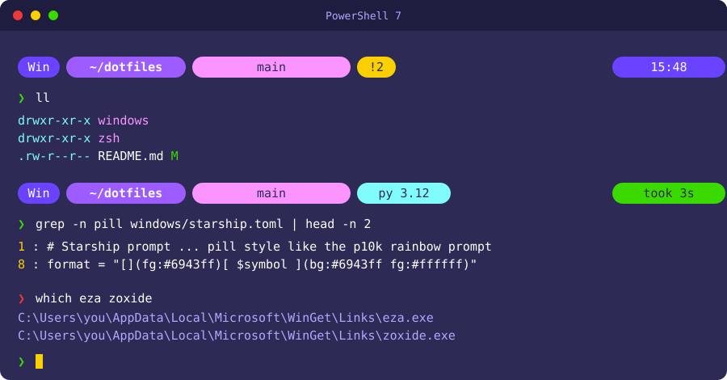

# dotfiles 가이드

처음이라면 [README](../README.ko.md) 부터.

<!-- toc -->
- [계층](#계층)
- [비밀값](#비밀값)
- [커밋 신원 검사](#커밋-신원-검사)
- [`pull-all`](#pull-all)
- [`update`](#update)
- [Windows (PowerShell)](#windows-powershell)
- [Claude Code 상태줄](#claude-code-상태줄)
- [Claude Code 가드](#claude-code-가드)
- [검사](#검사)
<!-- /toc -->

## 계층

```
zsh/zshrc               모든 OS
  └ zsh/os/<os>.zsh     darwin · linux · wsl (wsl 은 linux 를 먼저 불러온다)
      └ ~/.zshrc.local  이 PC 전용 — 비밀값, 호스트 하나용 별칭 (커밋하지 않음)
```

OS 는 셸 시작 때 판별하므로(`uname`, WSL 은 `/proc/version`) 같은 `~/.zshrc` 가 어디서나 돈다.
git 도 같은 방식이다: `git/gitconfig` 가 자격 증명 도우미용 `~/.gitconfig.local` 을 include 한다.

| 레포 안 | 링크 위치 | OS |
|---|---|---|
| `bin/*` | `~/.local/bin/` | 전체 |
| `zsh/zshrc`, `zsh/zshenv` | `~/.zshrc`, `~/.zshenv` | 전체 |
| `zsh/os/*.zsh` | `~/.zshrc` 에서 source | OS 별 |
| `zsh/p10k.zsh` / `zsh/p10k.darwin.zsh` | `~/.p10k.zsh` | Linux·WSL / macOS (Nerd Font 세대가 다름) |
| `git/gitconfig` | `~/.gitconfig` | 전체 |
| `git/hooks/` | `~/.config/git/hooks` | 전체 |
| `personal/git/gitconfig`, `allowed-emails`, `blocked-domains` | `~/.config/git/profile.gitconfig`, `~/.config/git/` | personal 만 |

**Git 훅** (`core.hooksPath` 로 전역 적용)은 모든 레포에서 돈다:

- `pre-commit` — 커밋 신원 검사(`~/.config/git/allowed-emails` 가 있을 때; personal 은 없으면 거부). `.pre-commit-config.yaml` 이 있는 레포는 `uvx pre-commit run` 도 돈다.
- `pre-push` — 신원 검사 후 `ci-local.py`: 레포의 `.github/workflows/ci.yml` 을 읽어 그 스텝들을 **푸시할 커밋** 위에서 돌린다(`.git/ci-local/` 아래 별도 워크트리 + venv). `services:` 잡과 `uses:` 액션은 건너뛰고 `continue-on-error` 는 따른다. 우회는 `git push --no-verify` 또는 `SKIP_CI_LOCAL=1`.

**호스트 간 레포와 크론** (상대 PC 는 `~/.gitconfig.local` 의 `sync.peers`, 실패 알림 스크립트는 `sync.alert`):

- `bin/pull-all` — `~/git` 아래 모든 레포를 fast-forward. `--ci-gate` 는 GitHub 체크가 초록인 커밋만 받고(빨강이거나 아직 도는 중이면 그대로 두고 ⏸ 로 보고), `--check` 는 뒤처진 레포만 보고한다.
- `bin/cron-install` — `~/git/*/deploy/crontab.<호스트>`(와 `*/personal/deploy/`) 를 레포마다 울타리 친 블록으로 사용자 crontab 에 설치한다. 울타리 밖 줄은 건드리지 않는다. 파일이 없으면 옛 블록을 유지하고, 잘못된 줄이 있으면 설치를 멈추며, 이전 crontab 은 `~/.local/state/cron-install/` 에 백업한다.
- `bin/ssh-keys-sync` — 모든 PC 의 `~/.ssh/authorized_keys` 를 GitHub 계정의 공개키 + `personal/ssh/authorized_keys` 로 맞춘다(Windows 는 `install.ps1`). 새 PC 는 GitHub 에 키를 올리면 다음 동기화 때 모든 PC 에 들어갈 수 있다. GitHub 에서 못 받거나 0개면 건드리지 않는다. `--check` 는 보고만.
- `bin/ssh-fallback` — 한 호스트의 주소 후보(유선 → Wi-Fi → `.local`)를 차례로 찔러 처음 열리는 곳으로 붙는 ssh `ProxyCommand`. `ProxyCommand ssh-fallback %p box-eth.lan box-wifi.lan box.local` 에 `HostKeyAlias box` 를 같이 쓴다. 연결 제한 옵션은 OS 에 맞춰 고르고(macOS `nc -G`, 그 밖 `-w`), 붙은 뒤 중계에는 유휴 제한을 걸지 않는다.
- `bin/repos-doctor` — 조용히 고장 난 git·훅·환경 설정(옛 경로를 가리키는 `core.hooksPath`, 깨진 `.venv` shebang, 끊긴 전역 링크 등)을 찾아 보고만 한다. 문제가 있으면 종료 코드 1.
- `bin/gh-protect` — 내 공개 레포마다 "main via PR" ruleset(기본 브랜치는 PR 로만, 승인 0개, force push·삭제 금지)을 건다. `--check` 는 빠진 레포만 보고한다. 새 공개 레포를 놓치지 않게 크론으로 매일 돌린다.
- 크론 작업은 `crontab -e` 가 아니라 레포의 `deploy/crontab.<호스트>` 를 고쳐 바꾼다.

그 밖의 링크:

| 레포 안 | 링크 위치 | OS |
|---|---|---|
| `vim/vimrc` | `~/.vimrc` — 첫 실행 때 Vundle 과 플러그인 설치 | 전체 |
| `npm/npmrc` | `~/.npmrc` | 전체 |
| `linux/systemd/rclone-gdrive.service` | `~/.config/systemd/user/` — `~/gdrive` 에 Google Drive, `gdrive` 리모트가 생기면 켜짐 | Linux |
| `claude/hud/statusline.sh` | `~/.claude/hud/` + `settings.json` 의 `statusLine` | 전체 |
| `claude/CLAUDE.md` | `~/.claude/CLAUDE.md` — **`--claude-md` 일 때만**. 끝에서 `~/.claude/CLAUDE.personal.md` 를 import | 전체 |
| `claude/hooks/guard.py` | `~/.claude/hooks/` + `settings.json` 의 가드 `PreToolUse` 항목과 `permissions.deny` | 전체 |
| `personal/ssh/config` | `~/.ssh/config.d/dotfiles-personal.conf` + `~/.ssh/config` 맨 위 `Include config.d/*.conf` — 모든 PC 가 같은 호스트 목록. 키는 동기화하지 않는다 | personal 만 |
| `personal/claude/agents/*.md`, `personal/claude/CLAUDE.md` | `~/.claude/agents/`, `~/.claude/CLAUDE.personal.md` | personal 만 |
| Orca 스킬 `orca-cli`, `orchestration`, `computer-use` | `orca skills install` 로 `~/.agents/skills/` + `~/.claude/skills/` — Orca CLI 가 있을 때(Linux 는 `orca-ide`) | 전체 |
| `macos/karabiner.json` | `~/.config/karabiner/` | macOS |
| `macos/vscode/settings.json` | VS Code 사용자 설정 | macOS · Linux 데스크톱 |
| `macos/Brewfile` | `brew bundle` — **`--brew` 일 때만** | macOS |
| `macos/vscode/extensions.txt` | `setup/ubuntu.sh` 가 설치, macOS 는 손으로 가져오기 | macOS · Linux 데스크톱 |
| `macos/brew_*.txt` | 참고용 / 손으로 가져오기 | macOS |

## 비밀값

여기엔 비밀값이 없다. API 키·비밀번호·토큰은 `*.local` 파일에 둔다:

| 파일 | 용도 |
|---|---|
| `~/.zshenv.local` | 비대화형 명령(`ssh host cmd`, cron)에 필요한 환경변수 |
| `~/.zshrc.local` | 대화형 전용 별칭과 함수 |
| `~/.gitconfig.local` | 자격 증명 도우미, 호스트별 git 설정 |

## 커밋 신원 검사

`git/hooks` 는 모든 레포에서 돈다(레포 자체 훅이 먼저 돈다):
`pre-commit` 은 `~/.config/git/allowed-emails` 에 없는 author/committer 를 거부하고, `pre-push` 는 `~/.config/git/blocked-domains` 의 도메인이 적힌 커밋 메시지도 거부한다.
두 파일은 personal 프로필이 링크한다. vanilla 에서 파일이 없으면 그 검사는 건너뛴다.
허용 목록은 레포 CI 의 Commit Identity Guard 와 같다 — 에이전트 신원은 author 가 아니라 `Co-Authored-By` 로만 남긴다.

## `pull-all`

디렉터리 안의 git 레포를 전부 fast-forward 한다.

```bash
pull-all                    # $PULL_ALL_ROOT 또는 ~/git 아래 레포
pull-all ~/src ~/work       # 이 디렉터리들 아래 레포
pull-all -j 8               # 8개 레포를 병렬로 fetch (기본 4)
ssh other-host pull-all     # 다른 PC 에서 같은 일
```

fast-forward 만 한다. 판단이 필요한 것은 보고만 하고 건드리지 않는다:

| | |
|---|---|
| `✓` | 이미 최신 (푸시 안 한 커밋이 있으면 `↑`) |
| `↓` | fast-forward 함 |
| `●` | 건너뜀 — 커밋 안 한 변경 또는 detached HEAD |
| `–` | upstream 브랜치 없음 |
| `✗` | fetch 실패 또는 히스토리가 갈라짐 |

SSH 호스트 키·자격 증명 프롬프트를 꺼 두어 멈춰 서지 않는다. 출력이 터미널이 아니거나 `NO_COLOR` 가 있으면 색을 끈다. 실패한 레포가 하나라도 있으면 0 이 아닌 코드로 끝난다.

## `update`

생각날 때 한 번 돌리면 그 PC 를 최신으로 맞춘다. 단계마다 `==> [n/N]` 을 찍고, 한 단계가 실패해도 나머지는
돌린 뒤 실패한 단계를 모아 보여 준다.

| | Linux · WSL (`zsh/os/linux.zsh`) | Windows (`windows/bin/update.cmd`) |
|---|---|---|
| 패키지 | apt update → full-upgrade → autoremove, snap | winget (UAC 한 번) |
| 도구 | uv tools, 전역 npm | uv tools, 전역 npm |
| OS | 펌웨어 목록만(설치는 `fwupdmgr update`), 재부팅 필요 알림 | Windows Update(드라이버·펌웨어는 목록만), `wsl --update` |

`update install foo` 처럼 인자를 주면 apt(Windows 는 winget)로 그대로 넘긴다.

## Windows (PowerShell)

`windows/bin/*` 은 zsh 별칭의 Windows 쪽이다. `install.ps1` 이 `~\.local\bin` 에 복사한다:

```powershell
pwsh -File C:\dev\git\dotfiles\windows\install.ps1
```

| 명령 | 하는 일 |
|---|---|
| `update` | 단계마다 `==> [n/5]` 를 찍으며: `uv tool upgrade --all`, 전역 `npm update -g`, 그다음 UAC 확인 한 번 뒤 관리자 창에서 winget upgrade --all(+ 아직 오래된 것 목록), Windows Update 소프트웨어 업데이트(드라이버·펌웨어는 목록만; 자동 재부팅 없음), `wsl --update`. Linux·WSL 은 위의 [`update`](#update) |
| `update --check` | winget 이 업그레이드할 목록만 보기 |
| `update install foo` | 그 밖의 인자는 그대로 winget 으로 |
| `cla` | `claude --dangerously-skip-permissions` |
| `doctor` | 되풀이되는 문제를 읽기 전용으로 점검: WSLService 가 꺼졌는지, 자주 쓰는 앱이 시작 프로그램에서 빠졌는지; 고치는 법을 출력 |

새 PC: `pwsh -File windows\setup.ps1` 이 `windows/winget-packages.json`(Windows 판 Brewfile)으로 `winget import` 를 한 뒤 `install.ps1` 을 돌린다. 목록은 `winget export -o windows\winget-packages.json` 으로 새로 받고, 런타임·프레임워크는 지운다(의존성으로 따라 들어온다).

`windows/bin` 이 PowerShell 프로필이 아니라 `.cmd` 심인 건 일부러다: cmd, Windows PowerShell 5.1, pwsh 7 어디서나 돌고, `Documents`(프로필이 거기 있는데 Defender 의 제어된 폴더 액세스가 잠글 수 있다)나 실행 정책(5.1 은 스크립트가 꺼진 채 나온다)에 기대지 않는다.

### 터미널 모양



`install.ps1` 이 Linux 의 zsh + p10k 와 비슷한 모양을 Windows 에도 맞춘다:

| 레포 안 | 하는 일 |
|---|---|
| `windows/terminal/shades-of-purple.json` | Windows Terminal 에 Shades of Purple 색 구성표 + `JetBrainsMono NFM` 글꼴을 병합하고, 메뉴에는 PowerShell 7 만 남긴다(cmd·Windows PowerShell 은 숨길 뿐 지우지 않는다) |
| `windows/starship.toml` | `~\.config\starship.toml` — p10k rainbow 와 비슷한 알약 모양 [Starship](https://starship.rs) 프롬프트 |
| `windows/powershell/profile.ps1` | `~\.config\powershell\profile.ps1` — Starship·zoxide 를 켜고 `ls`/`ll`(eza), `cat`(bat), `grep`(rg), `which`, `touch`, `head`, `tail`, `wc`, `sudo`, `gs`/`gl`/`gd` 같은 리눅스식 명령을 만든다 |
| `windows/orca/shades-of-purple.json` | Orca 터미널에 같은 테마(Orca 가 꺼져 있을 때만 적용) |

프로필은 `Documents` 밖(`~\.config\powershell\profile.ps1`)에 둔다. Controlled folder access 가 `Documents\PowerShell` 만들기를 막기 때문이다. 대신 PowerShell 설치 폴더의 all-users 프로필(`C:\Program Files\PowerShell\7\profile.ps1`, 관리자 권한으로 `install.ps1` 을 돌릴 때 한 번 쓴다)이 그 파일을 불러와서, Windows Terminal·Orca·VS Code·그냥 `pwsh` 어디서나 같은 프롬프트와 명령이 나온다. 글꼴과 도구(`starship`, `eza`, `bat`, `ripgrep`, `zoxide`, `fzf`, `delta`, `lazygit`)는 `winget-packages.json` 에 들어 있다.

## Claude Code 상태줄

`claude/hud/statusline.sh` — 모델, 디렉터리와 git 브랜치, 컨텍스트·사용량 한도, CPU / 메모리 / 온도 / GPU, 날씨, 호스트와 세션 이름. PC 가 줄 수 없는 부분(GPU 없음, 센서 없음, `node` 없음)은 뺀다. `jq` 가 필요하다.

네이티브 Windows 의 Git Bash 에서도 돈다: cwd 의 역슬래시를 바꾸고 CPU / 메모리는 PowerShell 에서 가져온다(캐시, 백그라운드 갱신). `install.sh` 는 bash 전용이라 거기선 `~/.claude/settings.json` 의 `statusLine.command` 를 손으로 적고, Git 의 bash 를 전체 경로로 가리킨다 — 그냥 `bash` 는 Windows 호스트에서 WSL 의 `bash.exe` 로 풀려 스크립트를 못 찾는다:

```json
"statusLine": {"type": "command", "command": "\"C:/Program Files/Git/bin/bash.exe\" \"C:/Users/<you>/.claude/hud/statusline.sh\""}
```

먼저 `jq` 를 설치한다(`winget install jqlang.jq`).

`~/.claude/settings.json` 에서 이것 때문에 바꾸는 건 `statusLine` 키뿐이다. 다른 훅, `env`, 플러그인은 PC 마다 따로 둔다.

## Claude Code 가드

`claude/hooks/guard.py` 는 `PreToolUse` 훅(Bash, Read, Edit, Write, Grep)으로, `--dangerously-skip-permissions` 에서도 다음을 막는다:

- **비밀값 유출**: `.env` 와 그 변형(`.env.example` 같은 템플릿은 괜찮다), `~/.claude/.credentials.json`, SSH 개인 키, `~/.zshenv.local`, `~/.pgpass` 를 읽기·출력·복사·전송하는 것, 그리고 불러온 뒤 환경을 쏟아내는 것(`env`, `printenv NAME`, `echo $..._DB/KEY/TOKEN`, `set -x`). 허용되는 것: 불러 쓰기(`set -a; . ./.env; set +a`, `export $(grep -v '^#' .env | xargs)`, `source <(grep ...)`), 키 이름만 보기(`cut -d= -f1`, `sed 's/=.*//'`, `grep -o '^NAME'`), 존재 확인(`grep -q`, `[ -n "$VAR" ]`), 이름으로 고른 비밀 아닌 키(`grep '^TIMESCALE_HOST=' .env`).
- **되돌릴 수 없는 것**: 강제 push(`--force-with-lease` 는 괜찮다), 공용 DB 테이블 삭제·비우기(psql/sqlite heredoc 도), crontab 지우기나 파일 통째 설치(레포가 `deploy/crontab.<호스트>` 를 가진다; `cron-install` 을 쓸 것), Docker 볼륨 삭제(DB 사본이 하나뿐), 재부팅·전원 끄기, `/`·`~`·`~/git`·`.`·`.git` 재귀 삭제, 메시지 없는 `git stash` / `pop` / `clear` / 그냥 `drop`(stash 스택은 모든 워크트리가 같이 쓴다).
- **운영 체크아웃**: crontab 이 돌리는 `~/git/<레포>` 에서 `main` 이외 브랜치로 바꾸거나 만드는 것(대신 워크트리에서 작업).

명령은 따옴표·`$( )`·heredoc 을 고려해 파싱한다: heredoc 으로 파일에 쓰는 글과 python heredoc 본문은 셸로 검사하지 않는다. 훅 항목은 실패 시 통과한다(파일 없음 → 허용). 테스트: `python3 claude/hooks/test_guard.py` 와 `claude/hooks/test_guard_extra.py`. 과거 도구 호출 약 1만 5천 건에 대해서도 다시 돌려 봤다. `install.sh` 는 홈 디렉터리 비밀 파일용 `permissions.deny` 도 합친다.

## 검사

`.github/workflows/ci.yml` 의 스텝은 GitHub Actions 와 `pre-push` 훅(`ci-local.py`) 둘 다 돌린다. `main` 은 PR 로만 받는다.

| 종류 | 스크립트 |
|---|---|
| 정적 검사 | `tests/test_shellcheck.sh`(style, `-x`), `tests/test_ruff.sh`, `tests/test_psscriptanalyzer.sh`, `tests/test_actionlint.sh`, `tests/test_typos.sh` |
| 공개 레포 | `tests/check_no_personal.py`(commit 때도 돈다)와 그 자체 테스트 `tests/test_check_no_personal.sh` |
| Windows 파일 | `tests/test_powershell.sh`(파싱), `tests/test_ps1_ascii.sh`, `tests/test_eol.sh`(`.cmd` 는 CRLF) |
| 동작 | `install`, `cron-install`, `pull-all`, `repos-doctor`, `ssh-keys-sync`, `ssh-fallback`, `gh-protect`, `update`, 신원 훅, Claude 가드 — `tests/test_*.sh`, `claude/hooks/test_guard*.py` |
